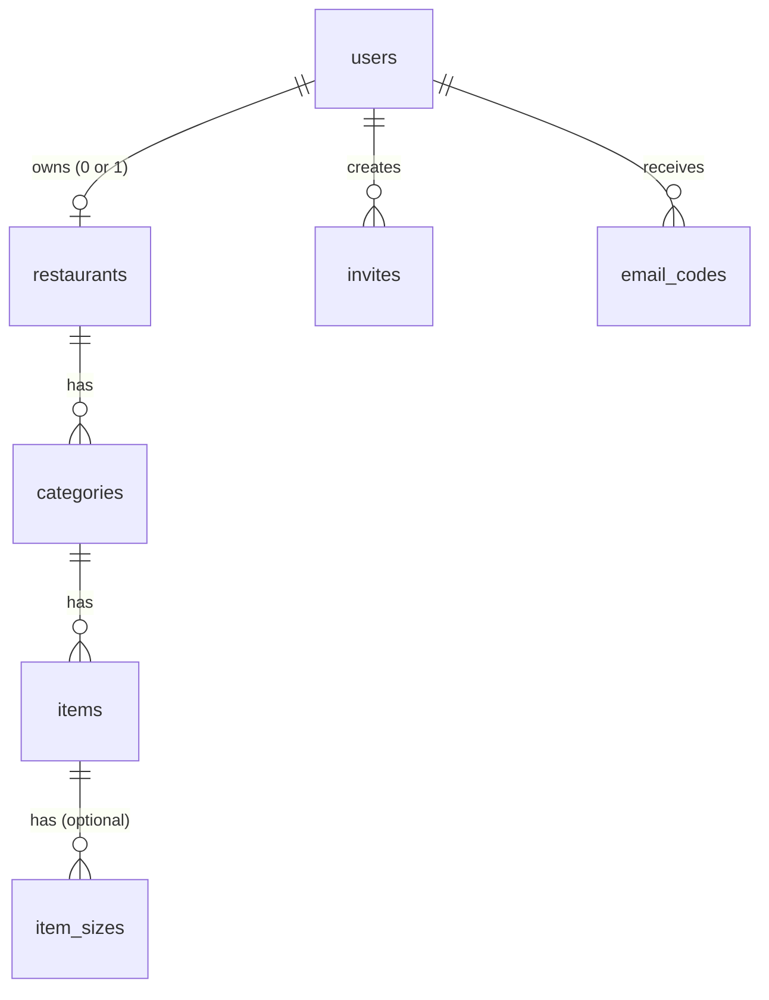

# qr-menu-saas

A multi-restaurant digital menu platform. Each restaurant gets its own account, a menu in the
language of its choice, a hard-to-guess public link, and a QR code to put on a table or a kiosk.

> Work in progress. Built as a portfolio project, using an AI coding agent through a
> pull-request workflow: every change is reviewed and understood before it is merged.

## Planned scope

1. **Accounts and menu**: invite-only sign-up, email verification, login, super-admin panel
   (invites, suspend, delete), per-restaurant menu with item sizes, public link, QR code.
2. **Look**: logo, colors and an optional background image per restaurant.
3. **Polish**: password reset, free-tier deployment, documentation.

## Stack

Next.js, TypeScript, PostgreSQL (Neon), Cloudinary (images), Vitest.

## Database design



Design decisions worth knowing:

- **Tenant isolation lives in the schema too.** `items` and `item_sizes` carry `restaurant_id`, and
  composite foreign keys make the database itself refuse an item pointing to another restaurant's
  category. The application still filters every query by the restaurant of the logged-in user,
  but a forgotten filter cannot silently link data across restaurants.
- **Random UUID ids** instead of 1, 2, 3, so ids cannot be guessed by counting. It is an extra
  layer, not a replacement for the ownership check.
- **Prices are `NUMERIC(12,2)`**: exact decimals, never floating point. A restaurant shows dollars,
  Lebanese pounds, or both (`currencies`), so items and sizes have `price_usd` and `price_lbp`.
- **Secrets are hashes.** Passwords, invite tokens and email codes are never stored as-is.
- **Account and restaurant are different things.** One restaurant per account (`UNIQUE owner_id`;
  drop it later to allow several). Deleting a restaurant keeps the account; deleting the account
  deletes its restaurant and everything in it.
- **Public link** = readable name + 10 random characters, e.g. `shaarcrepe-k3x9qp7vtz`.
- **One phone number** (international format) serves both the call and the WhatsApp button.
- **Names and descriptions are free text in any language**, so the owner types what he wants
  (`Burger`, `برغر`, or both). The page uses `dir="auto"` so each text gets the right direction.
- **Rules enforced by the application, not SQL** (they span two tables): an item has either its own
  price or at least two sizes, and the prices must match the currencies the restaurant chose.
- **Images live on Cloudinary**, outside the database: deleting rows does not delete the files, so
  application code must clean them up.

## Migrations

Schema changes are numbered SQL files in `db/migrations`. `npm run migrate` applies the new ones,
each in a transaction (the SQL and its record succeed or fail together), and records a checksum.
If an already-applied file is edited, the runner stops instead of letting dev and production
drift apart. Two runners at the same time are serialized with a per-transaction lock.

Which database is changed depends only on `DATABASE_URL` (copy `.env.example` to `.env.local`).
Always run a new migration on the **dev** database first, then on production.

## Running it

```
npm install
cp .env.example .env.local     # then fill DATABASE_URL and SESSION_SECRET
npm run migrate                # creates the tables in the database of DATABASE_URL
npm run create-admin           # creates the super-admin (asks email + password, hidden)
npm run dev                    # http://localhost:3000
```

`create-admin` refuses to run if a super-admin already exists. For the production database use
`npm run migrate:prod` and `npm run create-admin:prod` (they read `.env.production.local` and ask
you to type `yes` after showing which database they will touch).

## Login and security

- **Session**: a signed cookie that contains only the user id (`HttpOnly`, `Secure` in production,
  `SameSite=Lax`, 7 days). The user is re-read from the database on every request, so deleting an
  account or changing a role takes effect immediately.
- **Passwords**: scrypt with a random salt (built into Node). Format `scrypt$N$r$p$salt$hash`.
- **One generic error** for a wrong password and an unknown email, and the same amount of work in
  both cases, so nobody can discover which emails exist.
- **Rate limit** stored in the database (`login_attempts`): 5 failures in 15 minutes per IP and per
  email, then HTTP 429. Works on serverless, where memory is not shared between requests.
- **CSRF**: the login endpoint only accepts `application/json`, which another website cannot send
  from a plain form.
- **Two layers of protection**: `proxy.ts` quickly redirects visitors with no cookie, and every
  protected page checks the real session (`requireSuperAdmin`, `requireOwner`). The proxy alone
  is never trusted.

## Invitations

Owners cannot sign up on their own. The super-admin invites them from **/admin/invites**: the
server creates a random token, stores only its SHA-256 hash, and emails the link
(`APP_URL/signup?token=...`). The link works for **20 minutes**, once. The token is never sent
to the admin's browser, only to the owner's inbox. A new invite for the same email cancels the
older one, and an email that already has an account is refused. If the email cannot be sent, the
invite is deleted instead of staying open.

Emails go through any SMTP service chosen only by environment variables (see `.env.example`).
Without `SMTP_HOST`, on your computer, the email is printed in the terminal; on the deployed
site it refuses to run (so secret links never end up in the logs).

## Sign-up (`/signup?token=...`)

The page shows the form only while the invite is valid (not used, not expired, not replaced).
Every other case (unknown, used, expired, replaced) shows the same message, "الرابط غير صالح", so
nobody can learn which links exist. The email is taken from the invite and cannot be changed.
The owner types the restaurant name in any language and a password (8 characters or more).

Creating the account is **one SQL statement**: it uses up the invite, creates the owner (email
already verified, because the link came to his inbox) and creates his restaurant. There is never a
half-made account, and two people sending the same link at the same moment cannot both succeed.
If the email already has an account, nothing is created and the invite is not used up.

The public link is `/m/<readable-part>-<10 random characters>`. Arabic letters in the name are
written with Latin letters (sound-alike, not translated: `مطعم الشعار` becomes `mtam-alshaar`);
the restaurant name itself is stored and shown exactly as typed. A name with no usable letters
(emoji only) gives `menu`. Guessing links is limited to 5 tries per 15 minutes per IP.

## Owner dashboard (`/dashboard`)

Pages: Home (menu link, dashboard link, a QR code for each), Menu (categories), Settings.
Everything an owner can do is under `/api/owner/*`. The guard order is: 401 (not logged in) →
403 (not an owner) → 415 (not JSON) → 404 (bad id) → 400 (bad body).

**The restaurant is never sent by the browser.** The data functions in `src/lib/owner-menu.ts` take the
owner's own id (from his login) and find his restaurant inside the same SQL statement
(`restaurant_id = (SELECT id FROM restaurants WHERE owner_id = $1)`). An owner who sends another
restaurant's category id just gets 404.

- **Settings:** name (the public link never changes with it, so printed QR codes stay valid), currency
  (`USD`, `LBP` or `BOTH`), phone (`+961...`; Lebanese local numbers and Arabic digits are accepted),
  map link (https only), Instagram and Facebook (each optional, any combination; account name or the real
  link, other websites are refused so an icon can never lead somewhere else).
- **Currency change:** refused while some item or size has no price in the chosen currency; the same SQL
  statement counts them and only updates when there are none. Going back to one currency keeps the other
  price stored (just hidden).
- **Categories:** add, rename, move up/down, delete (its items are deleted with it, the confirmation
  window says how many). Up to 50 per restaurant. Moving renumbers 1..n inside one statement, so
  duplicates or gaps in `sort_order` cannot break the order.
- **Suspended restaurants:** when the admin suspends a restaurant, its owner can still log in and look,
  but every write is refused (403, "تم إيقاف مطعمك من الإدارة..."). This is enforced in the SQL of each
  write (`status = 'active'` next to the owner filter), not only by hiding buttons, so a direct request
  fails too. The dashboard shows a red banner and disables the forms. Activating it again restores
  everything. (The public menu page will show "unavailable" when it is built.)
- **Items and sizes** (`src/lib/owner-items.ts`): name, optional description (300 characters), category,
  price in each currency the restaurant uses, and "available today" (hidden without deleting). An item is
  either a plain item with its own price(s), or has 2 to 6 sizes (labels like S, M, L, XL: up to 6 Latin
  letters or digits) and then each size carries the prices and the item has none. Up to 300 items per
  restaurant. Saving an item with its sizes is **one SQL statement** (the item and all its sizes together or
  nothing). The currency rule ("every currency of the restaurant must have a price") is checked in the
  application for clear messages AND again inside the SQL, so a currency change in another tab cannot leave an
  item without a price. A price in a currency the restaurant stopped using is kept (hidden) when the item is
  edited. Prices: dollars up to 2 decimals (`3.5`, `3,50`), lira whole numbers (`150000`, `150,000`); zero,
  negative, `NaN` and scientific notation are refused. Prices come back from the database as exact text
  (never as floating point).
- **Completing missing prices** (`/dashboard/menu/prices`, `src/lib/owner-prices.ts`): to start using another
  currency, the owner first fills the prices that are missing in it. The settings page shows a warning with the
  number of missing prices and a link; the page lists only the items (or sizes) without a price in the currency
  the restaurant does not use yet (the browser never says which currency: the database decides). Saving is
  **one SQL statement, all or nothing**: every typed price must point to an item or size of the owner's own
  restaurant that is still empty; if one does not, nothing is saved. Existing prices are never overwritten, and
  the new prices stay hidden from customers until the currency is chosen in the settings.
- **Confirmation windows** are our own (`ConfirmDialog`, a native `<dialog>`), never the browser's `confirm()`.

## Tests

```
npm install
npm test
```

Tests run against a real PostgreSQL in memory ([PGlite](https://pglite.dev)): no account, no network.
