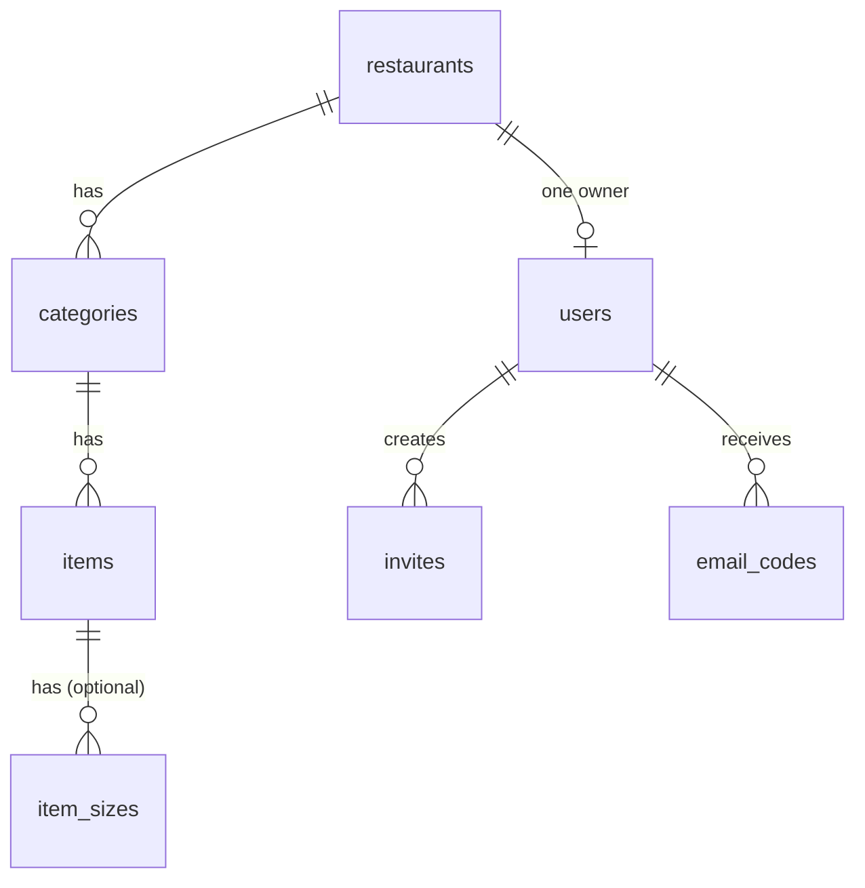

# qr-menu-saas

A multi-restaurant digital menu platform. Each restaurant gets its own account, a bilingual
(Arabic / English) menu, a hard-to-guess public link, and a QR code to put on a table or a kiosk.

> Work in progress. Built as a portfolio project, using an AI coding agent through a
> pull-request workflow: every change is reviewed and understood before it is merged.

## Planned scope

1. **Accounts and menu**: invite-only sign-up, email verification, login, super-admin panel
   (invites, suspend, delete), per-restaurant menu with item sizes, public link, QR code.
2. **Look**: logo, colors and an optional background image per restaurant.
3. **Polish**: password reset, free-tier deployment, documentation.

## Stack

Next.js, TypeScript, PostgreSQL (Neon), Cloudinary (images), Vitest.

## Database design



Design decisions worth knowing:

- **Tenant isolation lives in the schema too.** `items` and `item_sizes` carry `restaurant_id`, and
  composite foreign keys make the database itself refuse an item pointing to another restaurant's
  category. The application still filters every query by the restaurant of the logged-in user,
  but a forgotten filter cannot silently link data across restaurants.
- **Secrets are hashes.** Passwords, invite tokens and email codes are never stored as-is.
- **Prices are integers** in the smallest unit (cents / pounds), so there are no floating point errors.
- **One owner per restaurant** (`UNIQUE` on `users.restaurant_id`); a super admin has no restaurant.
- **Deleting a restaurant cascades** to its owner, categories, items and sizes. Images stored on
  Cloudinary are outside the database and must be cleaned up by application code.
- **Rule enforced by the application, not SQL:** an item has either a single price or at least two sizes.

## Migrations

Schema changes are numbered SQL files in `db/migrations`. `npm run migrate` applies the new ones,
each in a transaction, and records a checksum. If an already-applied file is edited, the runner
stops instead of letting dev and production drift apart.

Which database is changed depends only on `DATABASE_URL` (copy `.env.example` to `.env.local`).
Always run a new migration on the **dev** database first, then on production.

## Tests

```
npm install
npm test
```

Tests run against a real PostgreSQL in memory ([PGlite](https://pglite.dev)): no account, no network.
