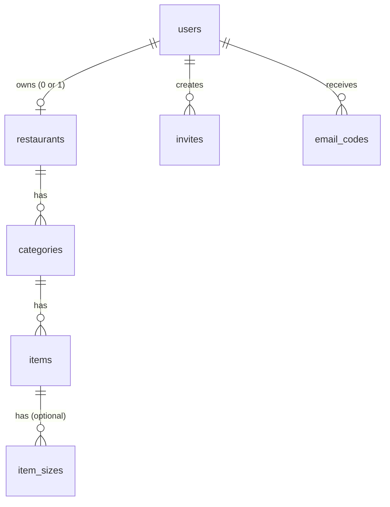

# qr-menu-saas

A multi-restaurant digital menu platform. Each restaurant gets its own account, a menu in the
language of its choice, a hard-to-guess public link, and a QR code to put on a table or a kiosk.

> Work in progress. Built as a portfolio project, using an AI coding agent through a
> pull-request workflow: every change is reviewed and understood before it is merged.

## Planned scope

1. **Accounts and menu**: invite-only sign-up, email verification, login, super-admin panel
   (invites, suspend, delete), per-restaurant menu with item sizes, public link, QR code.
2. **Look**: logo, colors and an optional background image per restaurant.
3. **Polish**: password reset, free-tier deployment, documentation.

## Stack

Next.js, TypeScript, PostgreSQL (Neon), Cloudinary (images), Vitest.

## Database design



Design decisions worth knowing:

- **Tenant isolation lives in the schema too.** `items` and `item_sizes` carry `restaurant_id`, and
  composite foreign keys make the database itself refuse an item pointing to another restaurant's
  category. The application still filters every query by the restaurant of the logged-in user,
  but a forgotten filter cannot silently link data across restaurants.
- **Random UUID ids** instead of 1, 2, 3, so ids cannot be guessed by counting. It is an extra
  layer, not a replacement for the ownership check.
- **Prices are `NUMERIC(12,2)`**: exact decimals, never floating point. A restaurant shows dollars,
  Lebanese pounds, or both (`currencies`), so items and sizes have `price_usd` and `price_lbp`.
- **Secrets are hashes.** Passwords, invite tokens and email codes are never stored as-is.
- **Account and restaurant go together.** One restaurant per account (`UNIQUE owner_id`;
  drop it later to allow several). The admin has ONE delete: it removes the account and, with it, the
  restaurant, categories, items, sizes and codes (all `ON DELETE CASCADE`). The same email can then be invited
  again. A "delete the restaurant only" button used to exist; it was removed because it left an account that
  could not make a new restaurant, could not be re-invited and was not listed, so nobody could delete it.
- **Public link** = readable name + 10 random characters, e.g. `shaarcrepe-k3x9qp7vtz`.
- **One phone number** (international format) serves both the call and the WhatsApp button.
- **Names and descriptions are free text in any language**, so the owner types what he wants
  (`Burger`, `برغر`, or both). The page uses `dir="auto"` so each text gets the right direction.
- **Rules enforced by the application, not SQL** (they span two tables): an item has either its own
  price or at least two sizes, and the prices must match the currencies the restaurant chose.
- **Images live on Cloudinary**, outside the database: deleting rows does not delete the files, so
  application code must clean them up.

## Migrations

Schema changes are numbered SQL files in `db/migrations`. `npm run migrate` applies the new ones,
each in a transaction (the SQL and its record succeed or fail together), and records a checksum.
If an already-applied file is edited, the runner stops instead of letting dev and production
drift apart. Two runners at the same time are serialized with a per-transaction lock.

Which database is changed depends only on `DATABASE_URL` (copy `.env.example` to `.env.local`).
Always run a new migration on the **dev** database first, then on production.

## Running it

```
npm install
cp .env.example .env.local     # then fill DATABASE_URL and SESSION_SECRET
npm run migrate                # creates the tables in the database of DATABASE_URL
npm run create-admin           # creates the super-admin (asks email + password, hidden)
npm run dev                    # http://localhost:3000
```

`create-admin` refuses to run if a super-admin already exists. For the production database use
`npm run migrate:prod` and `npm run create-admin:prod` (they read `.env.production.local` and ask
you to type `yes` after showing which database they will touch).

## Login and security

- **Session**: a signed cookie that contains only the user id (`HttpOnly`, `Secure` in production,
  `SameSite=Lax`, 7 days). The user is re-read from the database on every request, so deleting an
  account or changing a role takes effect immediately.
- **Passwords**: scrypt with a random salt (built into Node). Format `scrypt$N$r$p$salt$hash`.
- **One generic error** for a wrong password and an unknown email, and the same amount of work in
  both cases, so nobody can discover which emails exist.
- **Rate limit** stored in the database (`login_attempts`): 5 failures in 15 minutes per IP and per
  email, then HTTP 429. Works on serverless, where memory is not shared between requests.
- **CSRF**: the login endpoint only accepts `application/json`, which another website cannot send
  from a plain form.
- **Two layers of protection**: `proxy.ts` quickly redirects visitors with no cookie, and every
  protected page checks the real session (`requireSuperAdmin`, `requireOwner`). The proxy alone
  is never trusted.

## Invitations

Owners cannot sign up on their own. The super-admin invites them from **/admin/invites**: the
server creates a random token, stores only its SHA-256 hash, and emails the link
(`APP_URL/signup?token=...`). The link works for **20 minutes**, once. The token is never sent
to the admin's browser, only to the owner's inbox. A new invite for the same email cancels the
older one, and an email that already has an account is refused. If the email cannot be sent, the
invite is deleted instead of staying open.

Emails go through any SMTP service chosen only by environment variables (see `.env.example`).
Without `SMTP_HOST`, on your computer, the email is printed in the terminal; on the deployed
site it refuses to run (so secret links never end up in the logs).

## Sign-up (`/signup?token=...`)

The page shows the form only while the invite is valid (not used, not expired, not replaced).
Every other case (unknown, used, expired, replaced) shows the same message, "الرابط غير صالح", so
nobody can learn which links exist. The email is taken from the invite and cannot be changed.
The owner types the restaurant name in any language and a password (8 characters or more).

Creating the account is **one SQL statement**: it uses up the invite, creates the owner (email
already verified, because the link came to his inbox) and creates his restaurant. There is never a
half-made account, and two people sending the same link at the same moment cannot both succeed.
If the email already has an account, nothing is created and the invite is not used up.

The public link is `/m/<readable-part>-<10 random characters>`. Arabic letters in the name are
written with Latin letters (sound-alike, not translated: `مطعم الشعار` becomes `mtam-alshaar`);
the restaurant name itself is stored and shown exactly as typed. A name with no usable letters
(emoji only) gives `menu`. Guessing links is limited to 5 tries per 15 minutes per IP.

## Owner dashboard (`/dashboard`)

Pages: Home (menu link, dashboard link, a QR code for each), Menu (categories), Settings.
Everything an owner can do is under `/api/owner/*`. The guard order is: 401 (not logged in) →
403 (not an owner) → 415 (not JSON) → 404 (bad id) → 400 (bad body).

**The restaurant is never sent by the browser.** The data functions in `src/lib/owner-menu.ts` take the
owner's own id (from his login) and find his restaurant inside the same SQL statement
(`restaurant_id = (SELECT id FROM restaurants WHERE owner_id = $1)`). An owner who sends another
restaurant's category id just gets 404.

- **Settings:** name (the public link never changes with it, so printed QR codes stay valid), currency
  (`USD`, `LBP` or `BOTH`), phone (`+961...`; Lebanese local numbers and Arabic digits are accepted),
  map link (https only), Instagram and Facebook (each optional, any combination; account name or the real
  link, other websites are refused so an icon can never lead somewhere else).
- **Currency change:** refused while some item or size has no price in the chosen currency; the same SQL
  statement counts them and only updates when there are none. Going back to one currency keeps the other
  price stored (just hidden).
- **Categories:** add, rename, move up/down, delete (its items are deleted with it, the confirmation
  window says how many). Up to 50 per restaurant. Moving renumbers 1..n inside one statement, so
  duplicates or gaps in `sort_order` cannot break the order.
- **Suspended restaurants:** when the admin suspends a restaurant, its owner can still log in and look,
  but every write is refused (403, "تم إيقاف مطعمك من الإدارة..."). This is enforced in the SQL of each
  write (`status = 'active'` next to the owner filter), not only by hiding buttons, so a direct request
  fails too. The dashboard shows a red banner and disables the forms. Activating it again restores
  everything. (The public menu page will show "unavailable" when it is built.)
- **Items and sizes** (`src/lib/owner-items.ts`): name, optional description (300 characters), category,
  price in each currency the restaurant uses, and "available today" (hidden without deleting). An item is
  either a plain item with its own price(s), or has 2 to 6 sizes (labels like S, M, L, XL: up to 6 Latin
  letters or digits) and then each size carries the prices and the item has none. Up to 300 items per
  restaurant. Saving an item with its sizes is **one SQL statement** (the item and all its sizes together or
  nothing). The currency rule ("every currency of the restaurant must have a price") is checked in the
  application for clear messages AND again inside the SQL, so a currency change in another tab cannot leave an
  item without a price. A price in a currency the restaurant stopped using is kept (hidden) when the item is
  edited. Prices: dollars up to 2 decimals (`3.5`, `3,50`), lira whole numbers (`150000`, `150,000`); zero,
  negative, `NaN` and scientific notation are refused. Prices come back from the database as exact text
  (never as floating point).
- **Completing missing prices** (`/dashboard/menu/prices`, `src/lib/owner-prices.ts`): to start using another
  currency, the owner first fills the prices that are missing in it. The settings page shows a warning with the
  number of missing prices and a link; the page lists only the items (or sizes) without a price in the currency
  the restaurant does not use yet (the browser never says which currency: the database decides). Saving is
  **one SQL statement, all or nothing**: every typed price must point to an item or size of the owner's own
  restaurant that is still empty; if one does not, nothing is saved. Existing prices are never overwritten, and
  the new prices stay hidden from customers until the currency is chosen in the settings. Two saves at the same
  moment cannot overwrite each other or save half a batch: the rows are locked (`FOR UPDATE`) before they are
  counted.
- **Confirmation windows** are our own (`ConfirmDialog`, a native `<dialog>`), never the browser's `confirm()`.

## Public menu page (`/m/<public link>`)

What customers see after scanning the QR code (`src/lib/public-menu.ts`, `src/app/m/[slug]/page.tsx`).

- **No login, no JavaScript needed, ONE database query** (restaurant + categories + items + sizes together).
- **Only what is meant to be public:** available items only, categories without a visible item are hidden,
  prices only in the currencies the restaurant uses. A **suspended restaurant** shows
  "هذه القائمة غير متاحة حاليًا" and its items are not even read from the database.
- **Bad links:** a link that does not look like a real one (`[a-z0-9-]`, up to 60 characters) gives 404
  without asking the database; an unknown link gives the same 404.
- **Buttons:** call (`tel:`), WhatsApp (`wa.me`, digits only), map, Instagram, Facebook. Only the ones the owner
  filled in. External links open in a new tab with `rel="noopener noreferrer"`. They are text buttons, not the
  platforms' logos (logos belong to those companies; add the official ones from their brand pages if wanted).
- **Privacy:** the page asks search engines not to index it (`noindex`) and sends no referrer: the link is for
  the people who scan the code. Easy to change if a restaurant wants to be found on Google.
- Text uses `dir="auto"`, so Arabic and English names each get the right direction.
- **Cached, and refreshed the moment something changes** (`src/lib/public-cache.ts`): the menu of each
  restaurant is one cache entry named by its public link. Customers read the cache (no database query); every owner
  change (all owner endpoints go through `ownerRoute`, which refreshes after a success) and every admin action that
  customers can see (suspend, activate, delete) throws that entry away with `revalidateTag(tag, { expire: 0 })`,
  so the next customer normally gets fresh data (a suspended restaurant disappears at once), with the small
  exceptions listed below.
  A made-up link is never stored (otherwise anybody could fill the cache), and an entry lives 5 minutes at most
  even if a refresh were forgotten. A test checks that every owner endpoint uses `ownerRoute`.
  Known small limits: right after a deploy or a refresh, customers who arrive at the very same moment may each
  do one database query (not one per customer afterwards); the cache is shared between servers on Vercel.
  Two more known limits (a fix would need a shared lock such as Redis, too heavy for this project):
  (1) a customer's read that STARTED just before a change and finishes just after it may store the old menu;
  it disappears by itself within 5 minutes. (2) The 5 minutes are a time after which the entry is
  recomputed; if the database is down at that moment Next.js may keep serving the old entry until it recovers.
  The owner's restaurant link is read BEFORE his change is saved, so a failing read stops everything before anything
  is saved. The refresh AFTER the save only logs a failure (the change is saved, so the answer stays "ok" and the
  old copy ends by itself within 5 minutes).

## Printing and downloading the QR code (`/dashboard/qr`)

- A table card (restaurant name, QR code, "امسح الرمز لعرض القائمة", the short link) that the owner prints
  from the browser: one big card, or four per A4 page to cut. The print stylesheet hides the dashboard around it.
- **Downloads:** `GET /api/owner/qr?format=svg|png` (`src/lib/qr-download.ts`). The restaurant is found from
  the logged-in owner, never from the request, so nobody can download another restaurant's file. Only owners
  (401 not logged in, 403 not an owner, 400 unknown format). Sent as an attachment with a fixed file name,
  `no-store` and `nosniff`. PNG is 1200 px wide, SVG scales to any size. The downloaded files contain the code only;
  the name and the sentence are on the printed card.
- The code has the 4-square empty border (quiet zone) QR readers need.

## Forgot password (`/forgot`, `/reset?token=...`)

`src/lib/password-reset.ts` (logic) and `src/lib/password-reset-request.ts` (the two requests, testable without Next).

- **Owners only.** The super admin's password is changed with the script on the admin's own computer, so a stolen
  mailbox can never become the most powerful account. (`/forgot` still answers the same "ok" for his email.)
- **The same answer for everybody.** `/forgot` says "if this email is registered we sent a link" whether the email is
  an owner, a stranger or the admin: nobody can use it to find out who has an account. Everything that
  differs (looking the email up, writing the link, sending the mail) runs AFTER the answer (`after()`), so the
  answer takes the same time either way, and a failure there is logged, never shown.
- **The link** is like an invite: 32 random bytes, valid 20 minutes, works once. Only its SHA-256 hash is stored (in
  `email_codes`, purpose `reset_password`; a database leak gives no working link). A new request cancels the older
  link. The page `/reset` sends no referrer and asks not to be indexed (the token is in the address); the token goes
  to the server in the request body, never in a URL that is logged.
- **ONE SQL statement** uses up the link (it is deleted), changes the password, remembers the moment
  (`users.password_changed_at`) and cancels every other link of that person. Two people sending the link at the same
  moment: only one wins.
- **Old logins die.** The login cookie knows when it was made; a cookie older than `password_changed_at` is refused
  (`src/lib/session-user.ts`, checked on every request together with the database read). After a reset he must log in
  with the new password (no automatic login).
- **Limits.** `/forgot`: 5 per 15 minutes per address and per email (also for emails that do not exist, so the limit
  says nothing either). `/reset`: 5 wrong links per 15 minutes per address. A wrong-password counter of the email is
  cleared by a successful reset. Known small trade-off: somebody can ask 5 times for another person's email and
  keep him from asking for 15 minutes (the same trade-off as the login limit).
- Mistakes in the form (too short, not the same twice) are answered before the limit and do not use up the link.
- **Known small limits:** (1) somebody who logs in with the OLD password at the very same moment as the reset
  can get a cookie that survives it (it needs the old password and perfect timing); a fix would carry a password
  version inside the cookie. (2) A cookie made in the same second as the reset is accepted (on purpose: the person
  who just logged in with the new password must not be thrown out). (3) Two requests at the very same moment can
  leave two valid links for the same person; both still expire in 20 minutes and work once.

## The public page for customers

- **Sizes as buttons.** An item with sizes shows ONE price (the first size, in the order the owner set) and a button
  per size; choosing a size changes the price shown (`src/components/PublicSizes.tsx`). Without JavaScript the first
  size and its price are still shown.
- **Photo bigger on a tap.** A tap on a photo opens the same file (already downloaded) in a `<dialog>` over a dark
  background, closed by the X, a tap outside, or Escape (`PublicPhoto.tsx`). No second download, no extra storage.
- **Fresh menu when the customer comes back** (`RefreshOnReturn.tsx`): when the customer returns to the tab or unlocks
  the phone, the page asks once for the fresh menu (at most once every 10 seconds). There is NO timer: a page nobody
  looks at asks for nothing, so the database, the storage and the server are not loaded for nothing; the data comes
  from the cache (see above) and the photos from the browser's own cache.
- **Known small limit:** the page tells items apart by their place in the list. If the owner deletes an item while a
  customer has the page open (and the customer had chosen a size on it), the next item can show that size after the
  refresh. A fix needs an id per item and category in the public data (and in the cache); the harm is only a different
  size on show, one tap to change.
- Settings: a short note under the map field explains how to copy the link from Google Maps.

## Item photos (Vercel Blob)

**Every item has a photo (required).** The add / edit form asks for one and has no "remove photo" button (only
"change"); the server refuses an item without a photo too (400), so the rule also holds for a direct call. An old item
that was made without a photo (before this rule) can only be saved again together with a photo. Everything about
where the files live is in ONE file,
`src/lib/image-storage.ts`; to use another service later only that file changes.

- **Shrunk in the browser first** (`src/lib/compress-image.ts`): at most 640 px on the long side, WebP (JPEG on old
  browsers), usually 30-80 KB. Faster for the owner, faster page for the customer, little storage used.
- **The server checks again** (`src/lib/image-upload.ts`, `POST /api/owner/upload`), in this order: logged in (401) →
  an owner (403) → sent by our own page (a header another site cannot add) → small (413, 500 KB at most) →
  restaurant active → limit (60 photos per 15 minutes per owner) → really an image. The type is decided from the
  FIRST BYTES of the file (JPEG, PNG, WebP only; never SVG, which can hold scripts), not from the name or from what
  the browser says. The file name is random, the restaurant is found from the login, never from the request.
- **The database only holds links we made ourselves.** Saving an item accepts a photo link only if it is https, on OUR
  store's exact address (not just any Vercel store) and inside THIS restaurant's folder `restaurants/<id>/`
  (`isOwnImageUrl`). A stranger's link, another site, another store, or another restaurant's photo is refused.
  Our store's address comes from `BLOB_PUBLIC_HOST` if set, otherwise from the store id inside `BLOB_READ_WRITE_TOKEN`;
  with neither, no photo link is accepted.
- **Several items may share one photo.** A file is deleted only when NO item of the restaurant uses it any more
  (`src/lib/image-cleanup.ts`, checked after the change was saved).
- **No leftovers (best effort).** Replacing or removing a photo, deleting an item, a category, or a restaurant (admin)
  deletes the files. If the storage is down the owner's change is still saved; a forgotten file only costs space.
  A photo uploaded and then never saved (the owner left the form) also stays: that is why uploads are limited.
- **Known small limits (a fix costs more than the harm):** (1) a photo uploaded at the very same moment the
  administrator deletes that restaurant can stay in the storage with nothing pointing to it. (2) Two edit forms of the
  SAME item open at once: if the first one replaces the photo and the second one is saved afterwards, the item can end
  up pointing to a deleted file (a broken picture; uploading again fixes it). A real fix needs a version number on every
  item edit.
- **Keyboard:** the file input is visually hidden but still reachable with Tab, and the button shows a focus ring.
- **Fast for customers:** `` with fixed size, lazy loading, served by Vercel's CDN with a one-month cache.
- Setup: create a PUBLIC Blob store in the Vercel dashboard (region Frankfurt), put its token in `.env.local` as
  `BLOB_READ_WRITE_TOKEN` (never commit it). On Vercel, connecting the store to the project adds it for you.
- Free plan limits (Vercel Hobby): 1 GB storage, 10 GB transfer, 2,000 uploads a month; beyond that Blob stops for
  30 days (you are never charged). Tested here with a stand-in for the storage; the real service is not called by the tests.

## Tests

```
npm install
npm test
```

Tests run against a real PostgreSQL in memory ([PGlite](https://pglite.dev)): no account, no network.
