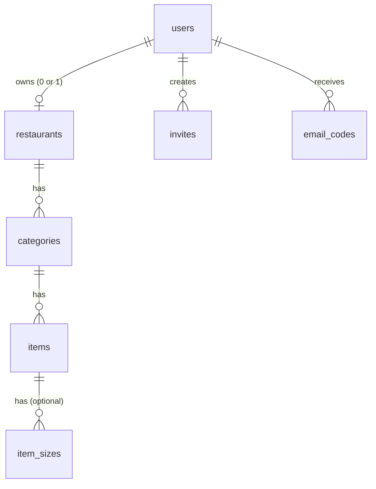

# qr-menu-saas

A multi-restaurant digital menu platform. Each restaurant gets its own account, a menu in the
language of its choice, a hard-to-guess public link, and a QR code to put on a table or a kiosk.

> Work in progress. Built as a portfolio project, using an AI coding agent through a
> pull-request workflow: every change is reviewed and understood before it is merged.

## Planned scope

1. **Accounts and menu**: invite-only sign-up, email verification, login, super-admin panel
   (invites, suspend, delete), per-restaurant menu with item sizes, public link, QR code.
2. **Look**: logo, colors and an optional background image per restaurant.
3. **Polish**: password reset, free-tier deployment, documentation.

## Stack

Next.js, TypeScript, PostgreSQL (Neon), Cloudinary (images), Vitest.

## Database design



Design decisions worth knowing:

- **Tenant isolation lives in the schema too.** `items` and `item_sizes` carry `restaurant_id`, and
  composite foreign keys make the database itself refuse an item pointing to another restaurant's
  category. The application still filters every query by the restaurant of the logged-in user,
  but a forgotten filter cannot silently link data across restaurants.
- **Random UUID ids** instead of 1, 2, 3, so ids cannot be guessed by counting. It is an extra
  layer, not a replacement for the ownership check.
- **Prices are `NUMERIC(12,2)`**: exact decimals, never floating point. A restaurant shows dollars,
  Lebanese pounds, or both (`currencies`), so items and sizes have `price_usd` and `price_lbp`.
- **Secrets are hashes.** Passwords, invite tokens and email codes are never stored as-is.
- **Account and restaurant are different things.** One restaurant per account (`UNIQUE owner_id`;
  drop it later to allow several). Deleting a restaurant keeps the account; deleting the account
  deletes its restaurant and everything in it.
- **Public link** = readable name + 10 random characters, e.g. `shaarcrepe-k3x9qp7vtz`.
- **One phone number** (international format) serves both the call and the WhatsApp button.
- **Names and descriptions are free text in any language**, so the owner types what he wants
  (`Burger`, `برغر`, or both). The page uses `dir="auto"` so each text gets the right direction.
- **Rules enforced by the application, not SQL** (they span two tables): an item has either its own
  price or at least two sizes, and the prices must match the currencies the restaurant chose.
- **Images live on Cloudinary**, outside the database: deleting rows does not delete the files, so
  application code must clean them up.

## Migrations

Schema changes are numbered SQL files in `db/migrations`. `npm run migrate` applies the new ones,
each in a transaction, and records a checksum. If an already-applied file is edited, the runner
stops instead of letting dev and production drift apart.

Which database is changed depends only on `DATABASE_URL` (copy `.env.example` to `.env.local`).
Always run a new migration on the **dev** database first, then on production.

## Tests

```
npm install
npm test
```

Tests run against a real PostgreSQL in memory ([PGlite](https://pglite.dev)): no account, no network.
